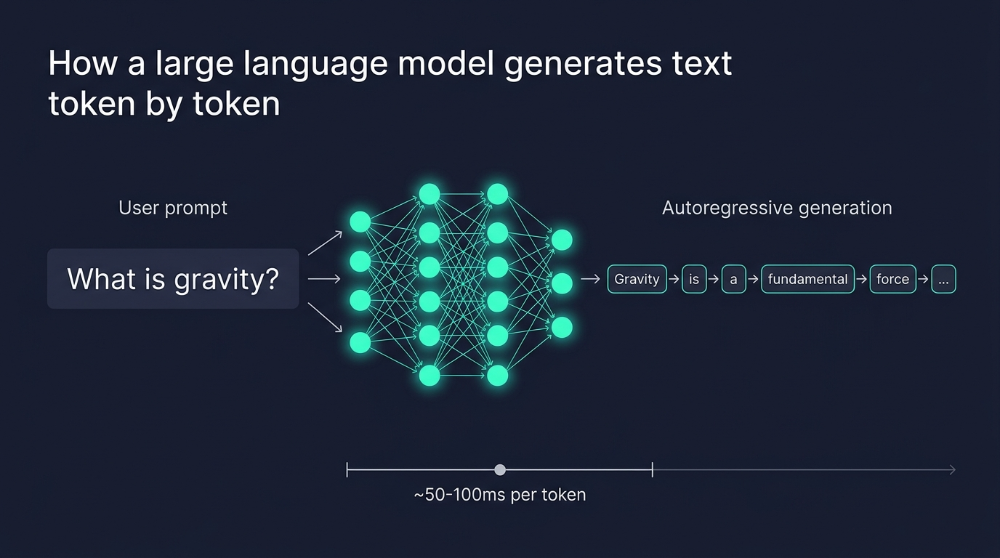
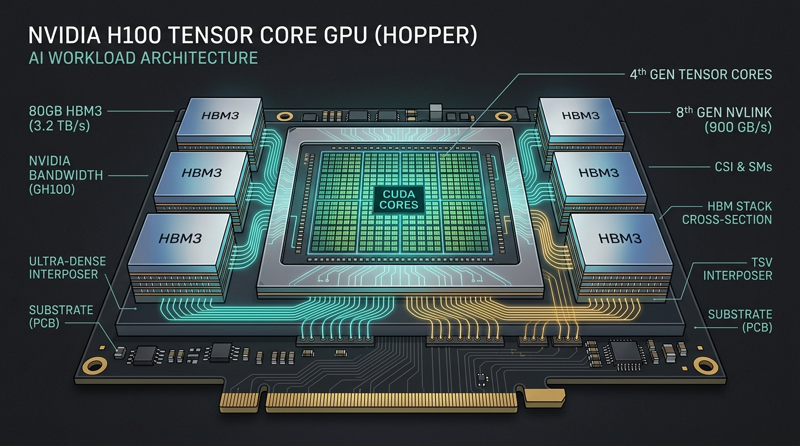
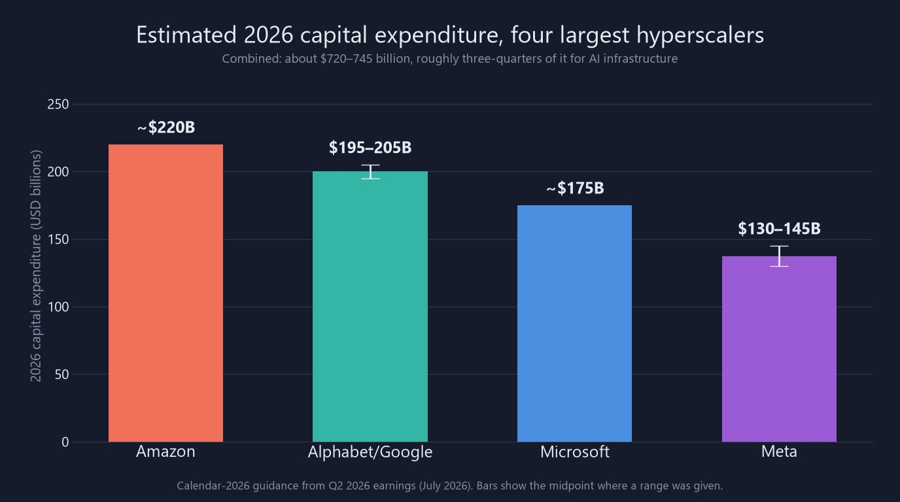
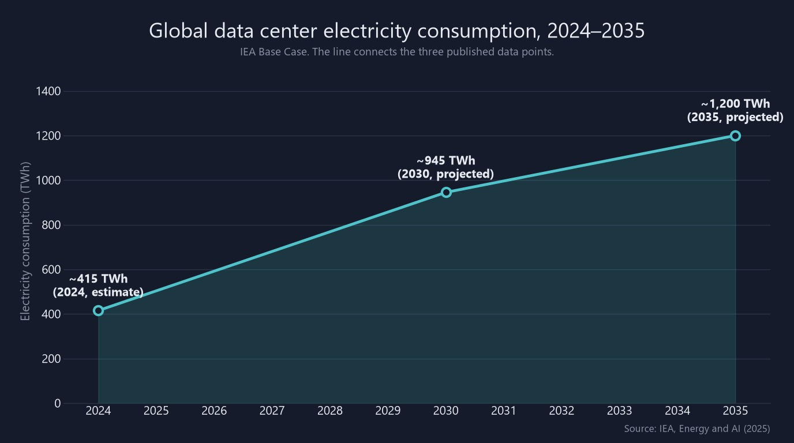
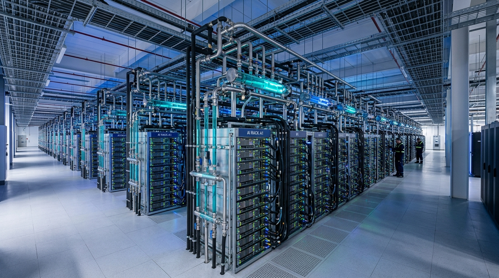

# The Hidden Infrastructure Behind Every AI Answer: GPUs, Inference, and Compute Costs

*By a technology writer who spent too many hours staring at server rack diagrams so you don't have to.*

---

You type a question into ChatGPT, Claude, or Gemini. A few seconds later, words begin streaming onto your screen, forming sentences that are often surprisingly coherent, occasionally brilliant, and, if you're unlucky, confidently wrong. The whole experience feels lightweight, almost effortless, like searching Google or sending a text. But behind those few seconds of waiting sits one of the most complex, expensive, and energy-hungry pieces of infrastructure humanity has ever built. What actually happens between the moment you hit "Send" and the moment that first word appears? The answer involves a global network of specialized hardware, billions of dollars in investment, and enough electricity to power small countries. This is the story of that hidden machinery.

*Illustrative diagram of the path your prompt takes: from your device, across the internet, to a cluster of GPUs in a data center that may be thousands of miles away. (Original illustration created for this article.)*

Let's start at the very beginning: your keyboard. When you type "Explain quantum computing like I'm five" into an AI chat interface, your browser packages that text into a standard HTTPS request, encrypts it, and sends it across the internet to whatever company built the model you're using. Depending on where you live and where their nearest data center sits, that request might travel a few hundred miles or several thousand. It passes through undersea cables, Internet exchange points, and content delivery networks before it lands at the front door of a data center. So far, this part looks pretty much like any other web request, like ordering something on Amazon, loading a YouTube video. The magic, and the money, begins once your prompt walks through that door.

The data center receiving your request isn't like the server closets you might have seen in office buildings. Modern AI data centers are purpose-built facilities the size of several football fields, filled with tens of thousands of specialized processors arranged in towering server racks. These facilities are often located in places with cheap electricity and cool climates, such as central Oregon, northern Virginia, the Nordic countries, parts of Iowa. They hum with a constant, low-frequency drone. The air (or increasingly, the liquid) circulating through them carries away enough heat to warm entire neighborhoods. And they exist for one primary reason: to run the kind of math that makes AI models work.

Before your prompt can become an answer, it needs to be translated into something a machine can work with. The model doesn't read English, or any human language, the way you do. Instead, your text goes through a process called tokenization, where the words get broken into smaller pieces called tokens, sometimes whole words, sometimes fragments. The word "quantum" might stay as one token, while "computing" might get split into "comput" and "ing." Each of those tokens is mapped to a numerical ID from the model's vocabulary, and those IDs are then converted into dense mathematical representations called embeddings: essentially, long lists of numbers that encode meaning. The word "king" ends up in a different mathematical neighborhood than the word "banana," and that's by design. These embeddings also get stamped with positional information so the model knows that the fifth word in your sentence came after the fourth one, because unlike older AI architectures, transformers process all the words at once rather than reading left to right.

*How autoregressive generation works: the model predicts one token at a time, feeding each new prediction back as input for the next step. A typical response of a few hundred words involves hundreds of these sequential forward passes. (Original illustration created for this article.)*

Now comes the part that actually requires all that expensive hardware. Your tokenized, embedded prompt enters the transformer neural network (the architecture described in the now-famous 2017 paper "Attention Is All You Need" by Vaswani et al.) and passes through dozens, sometimes over a hundred, layers of computation. At each layer, the model performs a mathematical operation called self-attention, which is the real engine of modern AI. Self-attention lets the model figure out which words in your prompt are most important relative to each other. When you write "The trophy didn't fit in the suitcase because *it* was too big," the attention mechanism is what helps the model understand that "it" refers to "the trophy" and not "the suitcase." It does this by computing three sets of vectors for every token, called queries, keys, and values, and then using the dot products between queries and keys to determine how much "attention" each token should pay to every other token. This happens billions of times per prompt across all the attention heads and layers. The sheer volume of arithmetic is staggering.

Here's the thing about generating a response, though: it doesn't happen all at once. Modern large language models are autoregressive, meaning they produce their output one token at a time. The model takes your prompt, processes it through all those layers, and outputs a probability distribution over its entire vocabulary: essentially a ranked list of every possible next token with a percentage chance assigned to each one. It picks one (using strategies like sampling or greedy selection), appends it to the input sequence, and then runs the entire process again to produce the next token. And the next. And the next. A response that's a few paragraphs long might involve three or four hundred of these sequential forward passes, each one requiring its own full trip through the neural network. This is why you see text streaming onto your screen word by word rather than appearing all at once. Each word is the result of a separate computation, and each computation typically takes a few tens of milliseconds on current hardware. That streaming effect isn't a UI gimmick. It's the actual pace of the math.

This is where the hardware story gets genuinely fascinating. The kind of math that transformers need (enormous matrix multiplications performed in parallel) is precisely the kind of work that graphics processing units were originally designed for. GPUs were built to render 3D graphics in video games, which involves applying the same mathematical transformation to millions of pixels simultaneously. It turns out that multiplying huge matrices together is structurally very similar to rendering a frame of Call of Duty, at least from the processor's perspective. That happy accident is why NVIDIA, a company that spent decades selling chips to gamers, now finds itself at the center of an industry worth hundreds of billions of dollars.

*Stylized cross-section of a modern AI GPU. The central die contains thousands of processing cores, surrounded by stacks of High Bandwidth Memory (HBM) that feed data to the cores at terabytes per second. The interplay between compute and memory bandwidth determines real-world inference speed. (Original illustration created for this article.)*

The GPU that's most likely processing your AI queries right now, if you're using a major chatbot service, is something from NVIDIA's Hopper or Blackwell family. The NVIDIA H100, which became the workhorse of AI data centers starting in 2023, is not a consumer graphics card. It's a specialized data center accelerator that costs between $30,000 and $40,000 for a single chip. A complete eight-GPU server system, like the DGX H100, can exceed $300,000 to $500,000. And no AI company buys just one. The largest AI training clusters contain tens of thousands of these GPUs, connected by ultra-fast networking fabrics like NVLink and InfiniBand that let them share data at hundreds of gigabytes per second. NVIDIA commands an estimated 80 to 90 percent of the AI accelerator market by revenue, a dominance built not just on superior silicon but on its CUDA software platform, which has become the default programming environment for machine learning over the past fifteen years.

What makes these chips so different from the CPU in your laptop? Mostly parallelism and memory bandwidth. A typical CPU has perhaps 8 to 24 cores, each one powerful and versatile. An H100 has over 16,000 CUDA cores, each one simpler and more specialized but capable of executing the same instruction across many data points simultaneously. More importantly, the H100 is surrounded by 80 gigabytes of High Bandwidth Memory (HBM3), which can feed data to those cores at 3.35 terabytes per second. For AI inference (the process of actually running a trained model), memory bandwidth is often the bottleneck rather than raw compute power. The model's parameters (think of them as the "knowledge" the model learned during training) need to be read from memory for every single token generated. For a model with hundreds of billions of parameters, that's an enormous amount of data being shuffled back and forth, which is why the speed of the memory matters so much.

The newer Blackwell architecture, including the B200 and GB200 chips, pushed these numbers even further and became NVIDIA's primary revenue driver through 2025 and 2026, with the upgraded Blackwell Ultra (B300 and GB300) driving NVIDIA's record data center sales in 2026 and its successor, Vera Rubin, now ramping into production. Demand was so intense that supply was effectively sold out for months after its initial rollout. Meanwhile, competitors are working to chip away at NVIDIA's dominance: AMD with its Instinct MI series, Google with its custom TPU (Tensor Processing Unit) chips, and Amazon and Microsoft with their own in-house silicon. But for now, if you ask an AI chatbot a question, the odds are strong that NVIDIA hardware is doing the heavy lifting.

The cost of running all this hardware at scale is where the numbers start to get truly eye-opening. When you send a message to an AI chatbot and receive a response, the company running that service is spending real money on your behalf: electricity, GPU depreciation, cooling, networking, staff. Figures published by the AI companies themselves suggest that a typical short text query to a frontier model consumes roughly 0.24 to 0.34 watt-hours of electricity (Google reports 0.24 Wh for a median Gemini text prompt, and OpenAI says an average ChatGPT query uses about 0.34 Wh), in the same range as the long-cited estimate of 0.3 Wh for a Google search. That sounds tiny, and for a single query, it is. But scale it up to hundreds of millions of queries per day across all the AI services now in operation, and the numbers become significant. And here's the catch: not all queries are equal. A simple "What's the capital of France?" costs a fraction of what a complex reasoning task, a long-document analysis, or an agentic workflow consumes. Advanced reasoning models (the ones that "think" through a problem step by step) use about 30 times more energy on average than models without reasoning, and in some tests hundreds of times more, because they generate far more internal tokens during their extended reasoning process.

The financial picture is shaped by how companies price their AI services. Subscription models like ChatGPT Plus at $20 per month or Claude Pro at a similar price point are designed to make the cost invisible to individual users. But behind the scenes, heavy users can generate compute costs that far exceed their subscription fee. On the API side, where developers and businesses pay per token, prices have dropped dramatically due to competition and efficiency improvements, and some commodity models now charge less than $0.40 per million tokens. Frontier reasoning models, however, remain significantly more expensive. Techniques like prompt caching (reusing the computation for a prompt that starts with exactly the same text as an earlier one) and batch processing (grouping many requests together for efficiency) can reduce costs by 50 percent or more for certain workloads, and they've become standard practice in production deployments.

*Estimated 2026 capital expenditure by the four largest hyperscale spenders (bars show the midpoint where a company gave a range). Combined, these companies are projected to invest roughly $730 billion in a single year, roughly three-quarters of which is directed at AI-specific infrastructure including GPUs, custom silicon, networking, and data center construction. Data sourced from company earnings guidance and analyst estimates as of mid-2026.*

To understand the scale of investment required to keep these systems running, look at what the biggest technology companies are spending. In 2026, the four largest hyperscale cloud providers (Amazon, Alphabet/Google, Microsoft, and Meta) are projected to spend a combined $720 to $745 billion in capital expenditure, most of it directed at AI infrastructure. Amazon alone has guided for roughly $220 billion, Alphabet for $195 to $205 billion, Microsoft for about $175 billion, and Meta for $130 to $145 billion. That is up roughly 77 percent from the record of around $410 billion the same four companies spent in 2025. Roughly three-quarters of this spending goes toward AI-specific infrastructure: purchasing GPUs and custom accelerators, building out high-speed networking, and constructing the physical data centers to house everything. Analysts project that the combined annual spending from this group could exceed $1 trillion by 2027. These are not speculative startups burning through venture capital. These are the most profitable companies on Earth, betting enormous sums that AI infrastructure will define the next decade of computing.

That money buys not just chips but the buildings, the power systems, and the cooling infrastructure needed to keep those chips running. A single modern AI data center can draw 100 megawatts or more of electrical power, about as much electricity as 100,000 households, according to the IEA. The largest campuses go far beyond that: OpenAI's Stargate site in Abilene, Texas, is designed for about 1.2 gigawatts, and Meta's planned Hyperion campus in Louisiana could eventually reach 5 gigawatts. According to the International Energy Agency, global data center electricity consumption reached approximately 415 terawatt-hours in 2024, accounting for roughly 1.5 percent of the world's total electricity use. The IEA projects this to more than double by 2030, reaching around 945 TWh, and to climb to approximately 1,200 TWh by 2035. AI-focused data centers are growing significantly faster than conventional ones: electricity demand from AI-optimized data centers is projected to more than quadruple by 2030.

*Projected global data center electricity consumption, 2024–2035. While efficiency per individual AI task continues to improve, the explosive growth in AI adoption is driving total demand sharply upward. Data: IEA, Energy and AI (2025), Base Case.*

The energy challenge extends beyond just having enough power. Someone has to deal with the heat. Every watt of electricity consumed by a GPU eventually becomes a watt of heat that needs to be removed from the building. Traditional air cooling (basically running very large, very expensive air conditioning) is reaching its physical limits as AI server racks climb to power densities of 80 to 120 kilowatts per rack, far beyond what conventional data centers were designed to handle. The industry response has been a rapid shift toward liquid cooling, where coolant flows directly to the hottest components through pipes and cold plates rather than relying on chilled air blown through the room. Market research firm TrendForce estimates that liquid cooling's share of AI chips grew from about 33 percent in 2025 to a projected 53 percent in 2026, and NVIDIA's Vera Rubin platform is designed to be fully liquid-cooled. These systems are significantly more efficient: they can achieve Power Usage Effectiveness (PUE) ratios below 1.2, compared to 1.4 to 1.6 for traditional air-cooled facilities, meaning a greater share of the electricity actually goes to computation rather than cooling overhead.

*Inside a modern AI data center designed for high-density GPU workloads. Visible liquid cooling pipes carry coolant directly to the processors, removing heat far more efficiently than traditional air cooling. Facilities like this are becoming the standard architecture for AI inference and training clusters. (Illustrative image created for this article.)*

But liquid cooling brings its own challenges, particularly around water consumption. Cooling towers and evaporative systems consume significant quantities of water, and in water-stressed regions, this has become a genuine point of contention between data center operators and local communities. Rystad Energy projects that without major efficiency gains, global data center water consumption could nearly triple by 2030, from about 222 billion liters in 2025 to 644 billion. Leading operators are responding with closed-loop cooling systems, hybrid approaches that minimize fresh water use, and in some cases, heat-reuse programs that pipe waste heat into district heating networks for nearby buildings. The industry is also beginning to adopt new metrics alongside PUE. Water Usage Effectiveness (WUE) tracks how much water is consumed per unit of IT energy, and some operators are exploring Power Compute Effectiveness (PCE), which measures how much of a site's provisioned power is actually allocated to computing hardware rather than lost to cooling, power conversion, or stranded capacity.

The engineering community working on inference (the process of actually running a trained model to produce outputs) has developed some remarkably clever optimizations to squeeze more performance out of this expensive hardware. One of the most important is the key-value (KV) cache. Remember how the model generates tokens one at a time, running through the network for each one? Without a cache, it would need to recompute the attention calculations for every previous token in the conversation every time it generates a new one. The KV cache stores those intermediate results in GPU memory, so the model only needs to compute attention for the newest token against the cached values of all the prior ones. This saves an enormous amount of redundant computation, but it comes at a cost: the cache itself eats into the GPU's limited memory, and it grows linearly with the length of the conversation. For models that support long context windows (some now accept hundreds of thousands of tokens of input), managing the KV cache becomes a first-class engineering challenge. Systems like vLLM use a technique called PagedAttention, inspired by how operating systems manage virtual memory, to pack KV caches more efficiently and allow more concurrent users per GPU.

Another clever technique is speculative decoding, which tackles the fundamental inefficiency of generating one token at a time. The idea is to use a small, fast "draft" model to quickly predict a batch of, say, five or ten upcoming tokens. Then the large, expensive model checks those predictions in a single parallel forward pass. If the draft model got them right (which it does surprisingly often for straightforward text), you've just generated multiple tokens at the cost of a single step. This can double or triple generation speed without sacrificing output quality, because the final verification is always done by the full model. Variants like EAGLE and Medusa have refined this approach further, achieving even higher acceptance rates. Continuous batching is another key optimization: rather than processing one request at a time, inference servers dynamically group many users' requests together so the GPU is always fully utilized. Static batching, which waits for a batch to fill up before processing, wastes GPU time whenever some requests in the batch finish before others. Continuous batching swaps in new requests as old ones complete, keeping the hardware saturated and improving throughput by anywhere from three to ten times.

Quantization rounds out the toolkit. Training a model typically happens in high numerical precision: 32-bit floating point or 16-bit. But for inference, many of those decimal places turn out to be unnecessary. By reducing the precision to 8-bit integers (INT8) or even 8-bit floating point (FP8), engineers can roughly halve the memory required to store the model and significantly speed up the math, all with minimal impact on output quality. This matters enormously in practice because it means larger models can fit on fewer GPUs, and each GPU can serve more users simultaneously. Frameworks like NVIDIA's TensorRT-LLM, vLLM, and SGLang have turned these optimizations from research papers into production-ready tools that power the inference behind most major AI services.

There's a broader economic tension underlying all of this infrastructure. Training a frontier AI model (the process of teaching it from scratch using vast amounts of text data) is spectacularly expensive, often costing tens or hundreds of millions of dollars for a single run. But training is a one-time cost (or at least, infrequent). Inference, by contrast, is an ongoing cost that scales with every user, every query, every token. As AI adoption has exploded, with hundreds of millions of people now using chatbots regularly, inference has grown into one of the largest costs AI companies face. Epoch AI estimates that OpenAI's compute in 2025 was split roughly evenly between research and inference, up from a smaller inference share in 2024. The industry is in the early stages of a shift from a training-dominated era to an inference-dominated one, and this is reshaping everything from chip design (NVIDIA's Blackwell architecture was explicitly optimized for inference efficiency) to data center architecture to business models.

The cost picture also varies dramatically depending on what kind of AI task you're running. A simple text completion is cheap. Image generation is more expensive. Video generation is significantly more expensive still. And the emerging category of agentic AI, where models don't just answer a question but plan, reason, use tools, write code, browse the web, and iterate over multiple steps, can consume orders of magnitude more compute than a straightforward chat interaction. When an AI agent spends several minutes reasoning through a complex coding task, executing code, revising its approach, and checking its work, it might generate thousands of internal tokens and make dozens of sequential model calls. Each of those calls involves its own trip through the GPU cluster. The compute cost of a single complex agentic task can easily exceed the cost of hundreds of simple chat messages.

What does all of this mean for you as a user? Mostly, it means that the apparent simplicity of the experience (type a question, get an answer) is one of the most impressive feats of abstraction in modern computing. A vast supply chain, from TSMC's fabrication plants in Taiwan where the GPU chips are manufactured, to the undersea cable networks that connect continents, to the power plants and cooling towers and fiber optic links that keep the data centers alive, all converges to produce those words on your screen. The $20 monthly subscription you might pay for an AI chatbot is, from the provider's perspective, a bet that the average user won't consume more compute than the fee covers, a bet that doesn't always pay off for heavy users. And the API pricing that businesses pay per token reflects a carefully calibrated model where the cost of the silicon, the electricity, the cooling water, the networking, the staff, and the buildings all get amortized across billions of tokens per day.

Perhaps the most remarkable thing about this infrastructure is how quickly it has been assembled and how rapidly it continues to evolve. Five years ago, the idea of needing to spend over $700 billion per year on AI data centers would have sounded absurd. The transformer architecture that makes this all possible was published less than a decade ago. The optimization techniques that make inference affordable (PagedAttention, speculative decoding, continuous batching, FP8 quantization) are only three to four years old. The industry is simultaneously building the airplane and flying it, figuring out how to make inference faster and cheaper even as the models grow larger and more capable and the number of users continues to climb. There is a genuine race happening between the increasing computational demands of more powerful AI models and the engineering ingenuity being deployed to keep those demands manageable.

Next time you ask an AI a question and see that text start streaming onto your screen, take a moment to appreciate what's happening in those few seconds. Your words traveled across the internet to a cavernous building humming with thousands of processors, each one worth more than a car. Your text was disassembled into fragments, converted into math, and fed through a neural network with hundreds of billions of learned parameters. That network performed trillions of arithmetic operations (multiplying matrices, computing attention scores, predicting one word at a time) using specialized silicon bathed in flowing coolant. The electricity powering that computation was drawn from a grid that's straining to keep up with the demand. And the resulting text was streamed back to your screen at the speed of its own generation, each token a small miracle of engineering, investment, and physics. The interface is simple. The machinery beneath it is anything but.

---

**References**

1. Vaswani, A., Shazeer, N., Parmar, N., et al. "Attention Is All You Need." *Advances in Neural Information Processing Systems*, 2017. [arxiv.org/abs/1706.03762](https://arxiv.org/abs/1706.03762)

2. International Energy Agency. "Energy and AI." April 2025. [iea.org/reports/energy-and-ai](https://www.iea.org/reports/energy-and-ai)

3. NVIDIA Corporation. "NVIDIA H100 Tensor Core GPU Architecture" whitepaper, 2022. [nvidia.com/en-us/data-center/h100](https://www.nvidia.com/en-us/data-center/h100/)

4. NVIDIA Corporation. "NVIDIA Blackwell Architecture" technical overview, 2024. [nvidia.com/en-us/data-center/technologies/blackwell-architecture](https://www.nvidia.com/en-us/data-center/technologies/blackwell-architecture/)

5. Kwon, W., Li, Z., Zhuang, S., et al. "Efficient Memory Management for Large Language Model Serving with PagedAttention." *Proceedings of the 29th Symposium on Operating Systems Principles (SOSP)*, 2023. [arxiv.org/abs/2309.06180](https://arxiv.org/abs/2309.06180)

6. Leviathan, Y., Kalman, M., Matias, Y. "Fast Inference from Transformers via Speculative Decoding." *International Conference on Machine Learning (ICML)*, 2023. [arxiv.org/abs/2211.17192](https://arxiv.org/abs/2211.17192)

7. Company earnings reports and capital expenditure guidance: Amazon (Q2 2026), Alphabet (Q2 2026), Microsoft (Q4 FY2026), Meta (Q2 2026). Available via respective investor relations pages.

8. Industry analyses on NVIDIA's AI accelerator market share (estimated 80–90% by revenue, 2024–2025) from semiconductor analyst firms including SiliconAnalysts and Precedence Research.

9. Data center cooling and PUE benchmarks from the Uptime Institute Global Data Center Survey, 2025.

10. API pricing and inference cost estimates based on published rate cards from OpenAI, Anthropic, and Google as of mid-2026, supplemented by independent cost analyses.

11. TrendForce. "Liquid Cooling Becomes Standard for High-End AI Infrastructure, with Penetration Expected to Reach 53% in 2026." August 17, 2026. [trendforce.com](https://www.trendforce.com/presscenter/news/20260817-13183.html)

12. Google. "How much energy does Google's AI use? We did the math." August 22, 2025. [cloud.google.com](https://cloud.google.com/blog/products/infrastructure/measuring-the-environmental-impact-of-ai-inference)

13. Altman, S. "The Gentle Singularity." June 2025. [blog.samaltman.com](https://blog.samaltman.com/the-gentle-singularity)

14. Hugging Face. "AI Energy Score v2: Refreshed Leaderboard, now with Reasoning." December 4, 2025. [huggingface.co](https://huggingface.co/blog/sasha/ai-energy-score-v2)

15. Rystad Energy. "Tech Thirst: Data center water consumption could triple by 2030 without efficiency gains." [rystadenergy.com](https://www.rystadenergy.com/news/data-center-water-consumption-could-triple-by-2030)

16. Epoch AI. "Introducing the AI Chip Users explorer." September 9, 2026. [epoch.ai](https://epoch.ai/latest/introducing-the-ai-chip-users-explorer)

17. Open Compute Project. Power Compute Effectiveness (PCE) white paper. October 2026. [opencompute.org](https://www.opencompute.org/wp-content/uploads/2026/10/OCP-PCE-White-Paper-Final.pdf)
